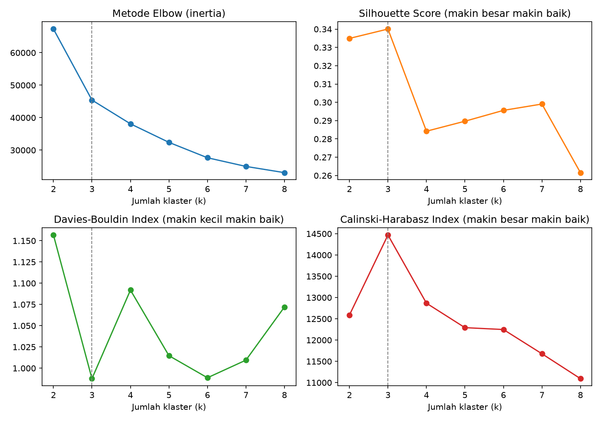
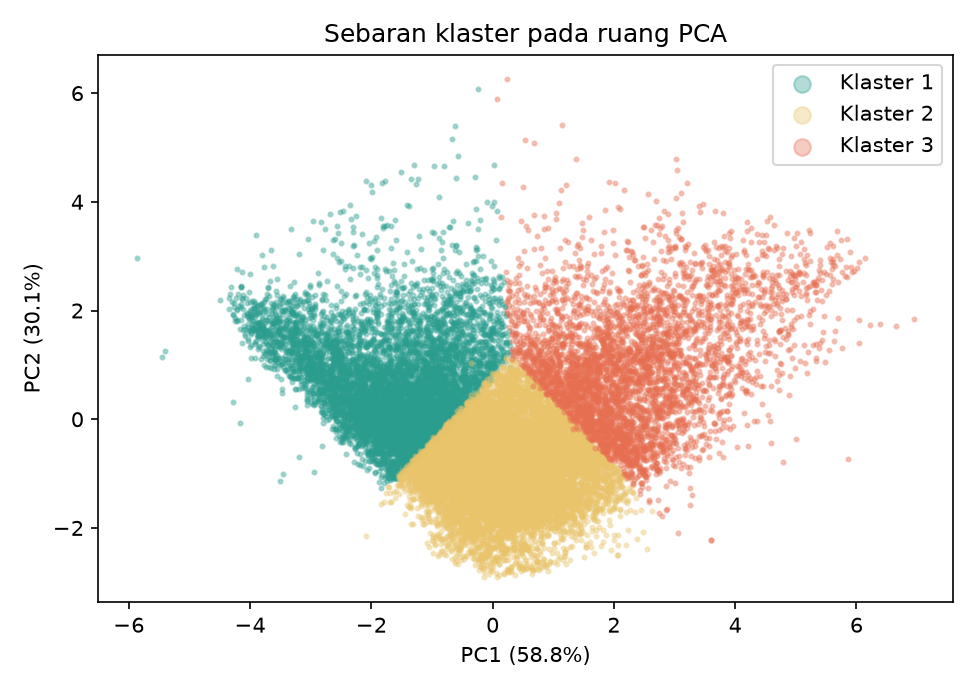
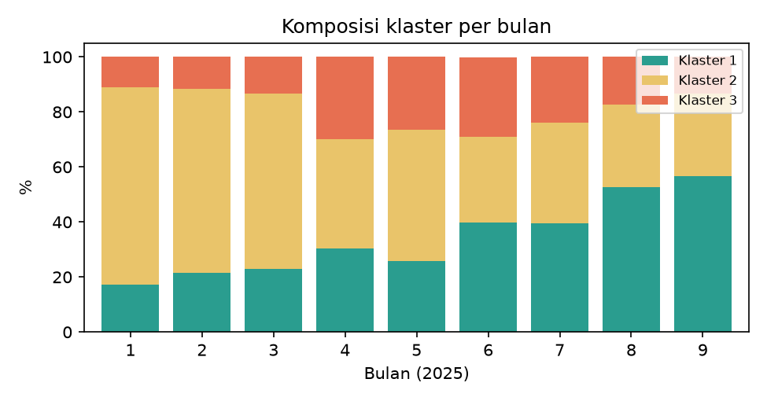

# Clustering-air-quality-in-Benowo-Surabaya

Tugas clustering: pengelompokan kondisi kualitas udara di Benowo, Surabaya, menggunakan **K-Means** (metode utama) dan **DBSCAN** (pembanding) pada data sensor tahun 2025.

> **Kelompok: 3** 
> **Mata kuliah: Machine Learning**  | **Dosen: Dr. Ir. Ricky Eka Putra, S.Kom., M.Kom.** 
>
> | No | Nama | NIM |
> |----|------|-----|
> | 1 | Mohamad Hafiz Sabar | 24051204071 |
> | 2 | Muhammad Fahreza Yudistira | 24051204103 |

## Dataset

- **Sumber:** pemantauan kualitas udara Benowo, Surabaya, Indonesia (Kendung Jaya VIA No. 21A, Sememi, Benowo, Surabaya)
- **Link:** https://data.mendeley.com/datasets/v9ykfbnvwk/1
- **Kontributor:** Lalu Muhamad Jaelani , Muhammad Ardian Syah
- **Instrumen:** [AirVisual Pro (IQAir)](https://www.iqair.com/air-quality-monitors/airvisual-pro)
- **Berkas:** `AirQuality_Benowo_xv6vmsv.xlsx`, sheet **2025**
- **Isi:** 21.756 baris, 1 Januari – 20 September 2025, interval 15 menit
- **Fitur dipakai:** PM2.5, PM10, CO2, suhu (°C), kelembapan
- **Tidak dipakai:** AQI US/CN dan PM1 (turunan atau hampir identik dengan PM2.5), suhu °F (identik dengan °C)

File dataset tidak disertakan di repositori ini. Letakkan `AirQuality_Benowo_xv6vmsv.xlsx` di folder yang sama dengan script sebelum menjalankannya.

## Alur Analisis

1. **Preprocessing:** hapus duplikat stempel waktu (21.756 → 21.753), buang outlier PM (batas Q3 + 3×IQR, menjadi 21.382 baris), standarisasi (`StandardScaler`).
2. **Pemilihan k:** Elbow, Silhouette, Davies-Bouldin, dan Calinski-Harabasz untuk k = 2–8. Keempatnya mendukung **k = 3**.
3. **K-Means (k = 3)**, profil tiap klaster, visualisasi PCA, serta sebaran klaster per jam dan bulan.
4. **Interpretasi** dengan kategori AQI US (AQI hanya untuk label, bukan fitur clustering).
5. **Pembanding DBSCAN.**

## Hasil Utama

| Klaster | Porsi | PM2.5 (µg/m³) | Suhu (°C) | Kelembapan (%) | Interpretasi |
|---|---|---|---|---|---|
| 1 | 33,6% | 30,8 | 31,8 | 68,2 | Siang panas dan kering, debu rendah-sedang |
| 2 | 46,4% | 32,0 | 27,6 | 85,4 | Malam sejuk dan lembap, debu rendah-sedang |
| 3 | 20,0% | 81,4 | 27,8 | 84,8 | Malam-pagi lembap, debu tinggi (mayoritas AQI "tidak sehat") |

- Silhouette 0,34: struktur klaster sedang, batas antar-klaster tidak tegas.
- DBSCAN tidak memberi pembagian bermakna (1–2 klaster atau banyak noise), sehingga K-Means dipilih.
- Polusi tinggi (Klaster 3) terutama terjadi malam hingga pagi, dan paling sering pada April–Juni.





## Cara Menjalankan

```bash
git clone <url-repositori-ini>
cd clustering-kualitas-udara-benowo
pip install -r requirements.txt
python clustering_kualitas_udara_benowo_2025.py AirQuality_Benowo_xv6vmsv.xlsx
```

Keluaran (gambar PNG dan tabel CSV) disimpan di folder `hasil_clustering/`.

## Struktur Repositori

```
.
├── README.md
├── requirements.txt
├── clustering_kualitas_udara_benowo_2025.py   # seluruh analisis
└── hasil_clustering/                          # gambar dan tabel hasil
```

## Keterbatasan

- Satu sensor di satu lokasi, tanpa pembanding stasiun referensi.
- Data berakhir 20 September 2025; Maret dan Juli tidak lengkap.
- Pembuangan outlier juga menghilangkan sebagian kejadian polusi ekstrem yang nyata.
- Pengamatan per 15 menit saling berkorelasi waktu, sedangkan K-Means menganggapnya independen.

## Referensi

- MacQueen, J. (1967). Some methods for classification and analysis of multivariate observations.
- Rousseeuw, P. J. (1987). Silhouettes: A graphical aid to the interpretation and validation of cluster analysis.
- Ester, M. dkk. (1996). A density-based algorithm for discovering clusters in large spatial databases with noise.
- Pedregosa, F. dkk. (2011). Scikit-learn: Machine learning in Python.
- WHO (2021). Global air quality guidelines.
